# Diseño Detallado: Ruta de Origen

> **Versión:** 1.0 &nbsp;&bull;&nbsp; **Fecha de Modificación:** 28/10/2026
>  **Autor:** Juan Esteban Jaramillo Ramírez
---

## 1. Introducción

### 1.1 Propósito

Este documentos esta redactado con el proposito de explicar el diseño detallado de **Ruta de Origen**, una plataforma de trazabilidad de café que permite registrar y consultar el recorrido de un lote desde la finca hasta la bolsa que llega el consumidor. Su objetivo es servir como referencia técnica para quien construya, opere o evolucione el sistema, y dejar documentadas las decisiones de arquitectura que sustentan la implementación.

### 1.2 Alcance

El documentos cubre la transacción del sistema:

1. Registro de finca y lote
2. Registro de las tres etapas consecutivas del lote: proceso de finca, tostión y empaque
3. Carga y procesamiento de evidencias asociadas a cada etapa
4. Generación del código QR del lote
5. Consulta pública de la trazabilidad mediante un código QR
6. Confirmación por correo electrónico del resultado del procesamiento de evidencias

La solución se compone en cinco servicios desplegables (`web`, `traceability`, `qr`, `processor` y `notifications`) y de una biblioteca compartida (`lib`)

### 1.3 Definiciones

| Término | Definición |
|---|---|
| Lote | Unidad de café cuya trazabilidad se registra. Pasa por tres etapas consecutivas, sin omitir ninguna. |
| Etapa | Cada paso de la cadena: proceso en finca, tostión y empaque. |
| Evidencia | Archivo (imagen) que respalda una etapa del lote. |
| Actor | Usuario registrado en el sistema. Puede ser organización, productor, tostador o marca. |
| Outbox | Tabla en la que un servicio guarda los eventos a publicar dentro de la misma transacción que modifica sus datos. |
| Inbox | Registro de los mensajes ya procesados (`processed_event`) que permite que los consumidores sean idempotentes. |
| DLQ | Cola de mensajes fallidos asociada a cada cola de consumo. |

### 1.4 Referencias

Este proyecto toma como referencia decisiones ya previamente tomadas por medio de ADR's y Pruebas de Concepto, los cuales están en el repositorio y pueden ser vistos por el que esté leyendo este documento.

* Repositorio de Documentación: [Decisiones de Arquitectura (ADR)](./docs/adr/) y [Pruebas de Concepto (PoC)](./docs/poc/)

## 2. Visión General de la Arquitectura

Se adopta una arquitectura de **microservicios** en la que cada servicios es dueño de sus propios datos y se comunica a los demás mediante eventos asíncronos sobre RabbitMQ. Las consultas de los usuarios llegan por HTTP a través de su único punto de entrada.

Cada servicio esta escrito en Go siguiendo Clean Architecture con puertos y adaptadores: El dominio no depende de ninguna tecnología, los casos de uso dependen de puertos (interfaces) y la infraestructura implementa esos puertos. En cuanto al frontend (`web`) se organiza por funcionalidades, de forma más simple.

## 3. Vista de Despliegue

El sistema se ejecuta sobre un servidor Proxmox VE. El clúster **k3s** corre en un contenedor LXC y la infraestructura de datos y secretos corre en contenedores LXC independientes.

El acceso público se realiza mediande **Cloudflare Tunnel** desplegado en k3s, evitando la necesitad de abrir puertos en la red. El tráfico llega a **Traefik**, que actúa como proxy inverso y enruta las peticiones, encargandose tambien del rate-limiting y del autoescalado con HPA.

El códigue reside en un solo repositorio con desarrollo basado en trunk-based development. Cada cambio llega al main mediante *pull request*; Github Actions ejecuta pruebas y análisis, publica las imagenes en GHCR y actualiza la etiqueta de imagen en los valores del chart Helm. **Argo CD** observa este repositorio y sincroniza el clúster. Los secretos se almacenan en OpenBao y se inyectan en los pods mediante External Secrets, de modo que ninguna configuración sensible esta presente en el código.

Cada servicio cuenta finalmente con sondeos de salud (`/healthz` y `readyz`).

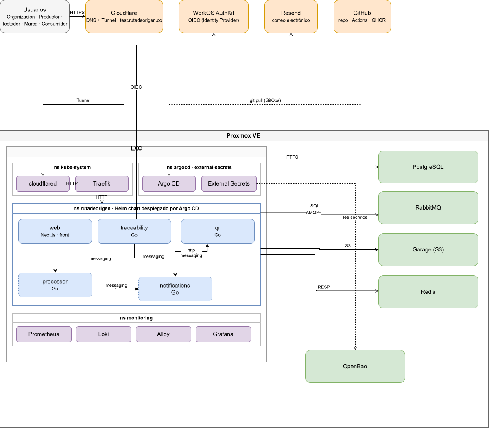

## 4. Vista de Paquetes

Todos los 4 servicios principales comparten la misma organización de paquetes bajo `internal/`, en el diagrama se puede observar el flujo de la lógica de estos paquetes:

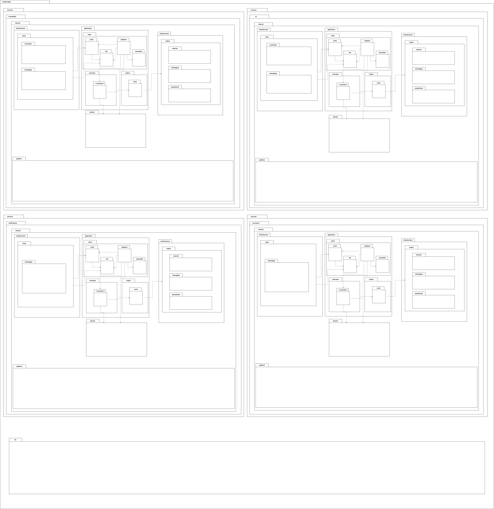

## 5. Vista de Componentes

Los diagramas muestran las dependencias de cada servicios: la plataforma base, librerías externas y componentes propios.

### 5.1 Biblioteca Compartida `lib`

Agrupa lo que reutilizan todos los servicios: mensajería sobre RabbitMQ con confirmaciones de publicación, registro de logs, contexto de petición, autenticación con WorkOS y circuit breaker.

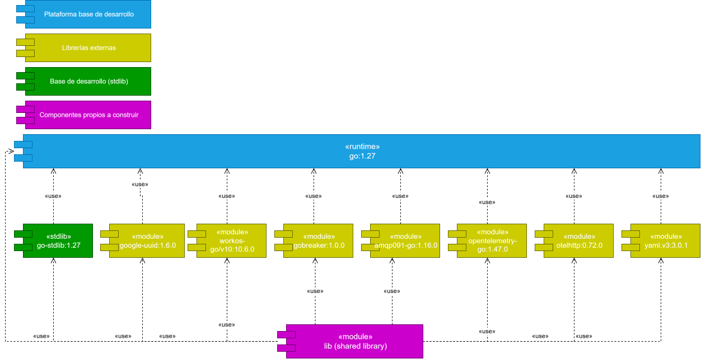

## 5.2 Servicio `traceability`

Es el servicio central del dominio. Gestiona actores, fincas, lotes y eventos de etapa, aplica la autorización y publica eventos de lote mediante outbox.

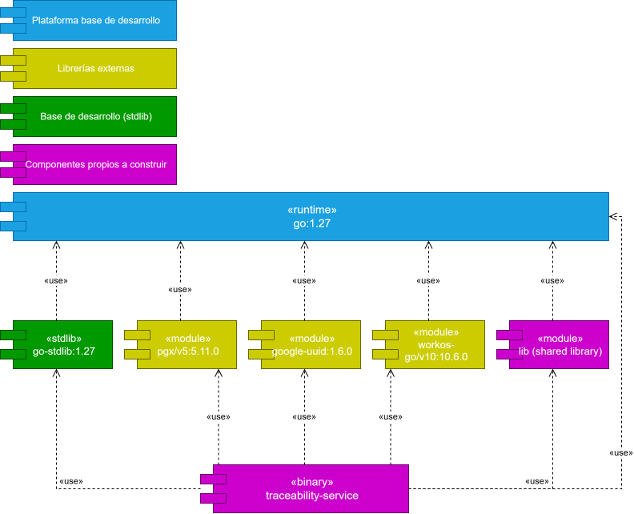

## 5.3 Servicio `qr`

Mantiene una proyección de lectura del lote a partir de los eventos que consume, genera la imagen del QR bajo demanda y atiende el escaneo y la consulta pública. Usa Redis como caché de la ficha del lote.

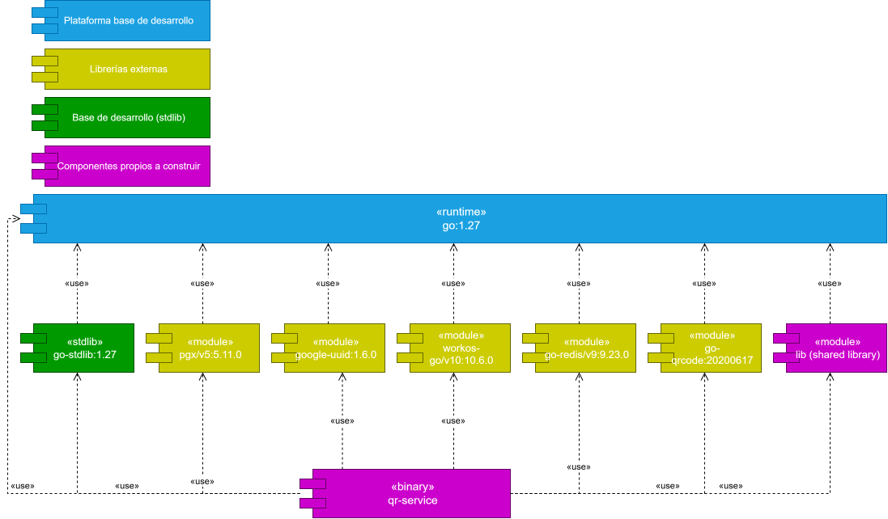

## 5.4 Servicio `notifications`

Consume los eventos de resultado del procesamiento de evidencias y envía el correo correspondiente mediante Resend. Protege la llamada al proveedor externo con un circuit breaker y registra cada envío para no notificar dos veces.

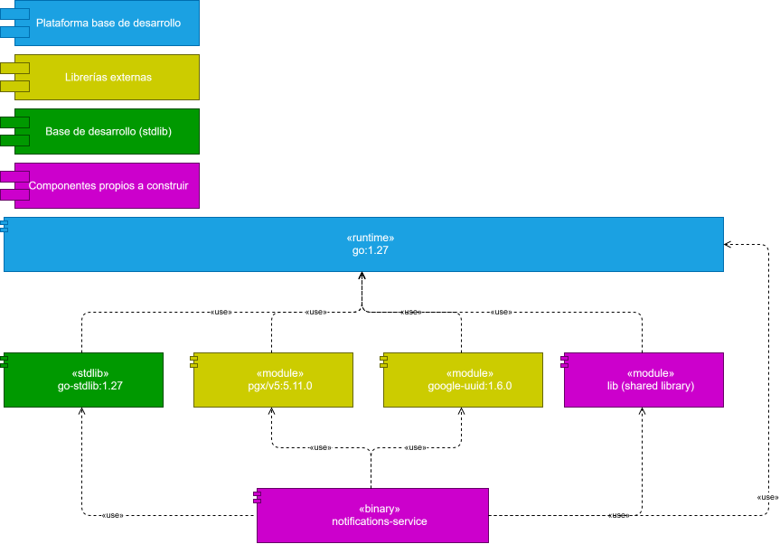

## 5.5 Servicio `processor`

No expone HTTP, salvo las sondas de salud. Consume las evidencias cargadas, las valida y las traslada del almacenamiento de cuarentena al definitivo. Por el momento solo admite imágenes.

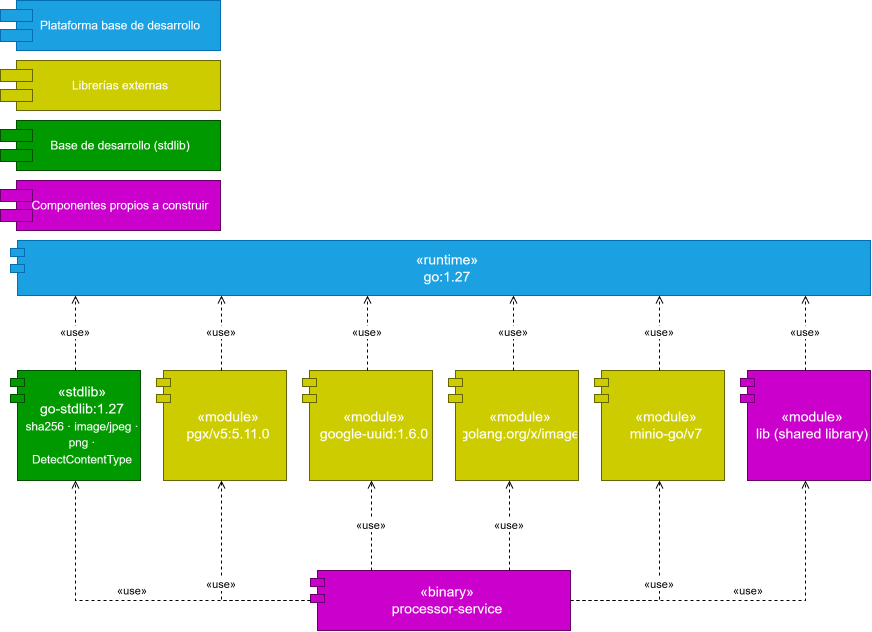

## 6. Vista de Interacción

Los diagramas de secuencia muestran el paso de cada solicitud por las capas del servicio: controlador, adaptador, caso de uso, dominio y repositorios. En todos los casos de escritura, el cambio de estado y el evento a publicar se guardan en una sola transacción.

### 6.1 Registrar Lote

El productor envía los datos del lote. El controlador resuelve el actor de la sesión, el adaptador convierte la solicitud en un borrador de dominio y el caso de uso valida que el actor esté activo, que la finca exista y que la acción esté autorizada. Después crea el lote en etapa de finca, comprueba que el código no esté repetido y, dentro de una transacción, guarda el lote y el evento `lot.created` en el outbox. Un relay publica el evento en RabbitMQ y el servicio `qr` lo proyecta de forma idempotente. Las violaciones de validación, permiso o unicidad se devuelven con el código de error del catálogo.

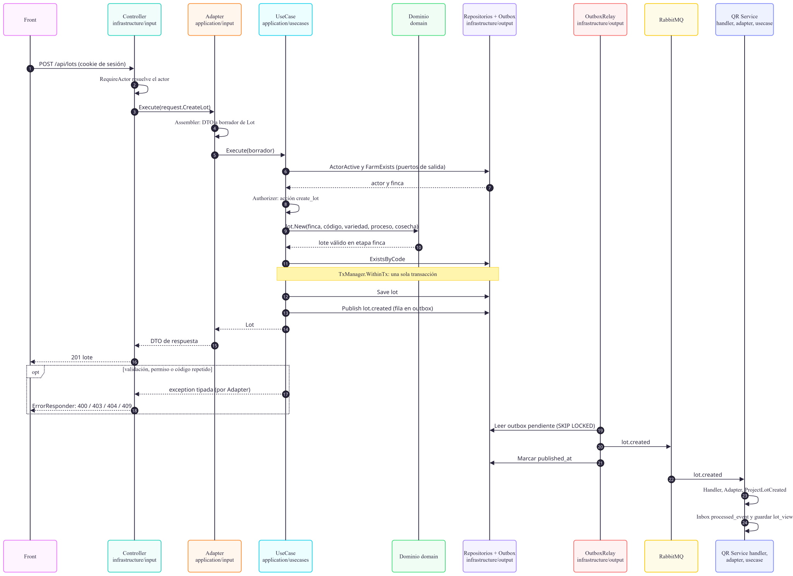

### 6.2 Registrar Etapa

El cliente envía la etapa con el encabezado `If-Match`, que contiene la versión del lote que conoce. Si la versión no coincide, la operación se rechaza. En caso contrario, dentro de una transacción el dominio verifica el orden (finca, tostión y empaque, sin saltos), se calcula el evento con su hash encadenado, se actualiza la versión del lote, se guarda el evento y se registra `lot.stage_registered` en el outbox. La respuesta incluye el nuevo `ETag`.

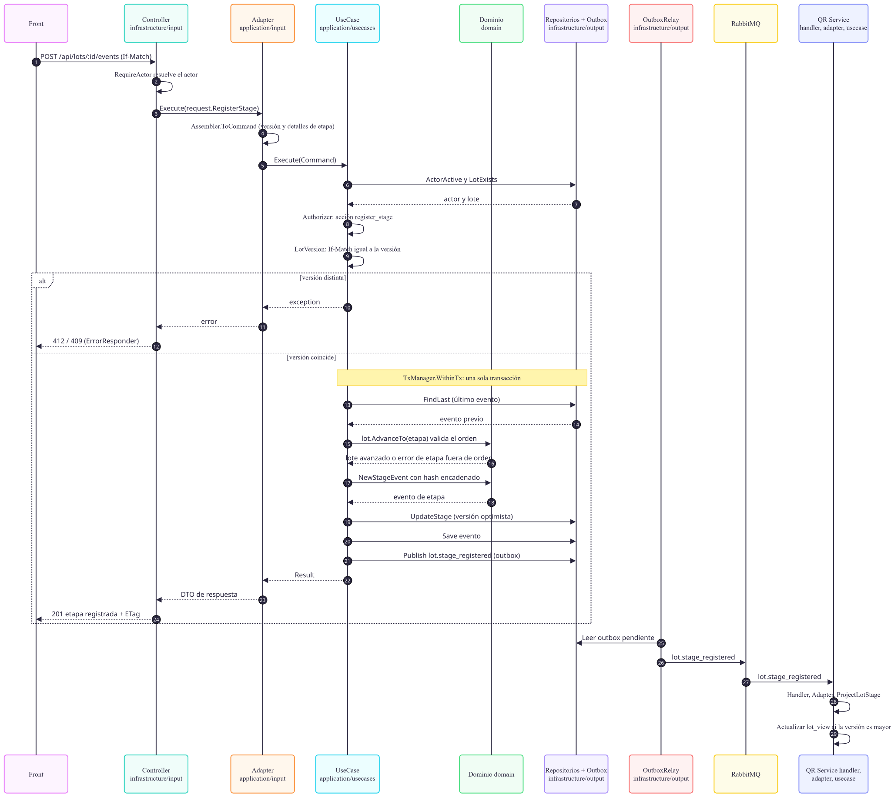

### 6.3 Subir y Procesar Evidencia

El archivo se envía a `traceability`, que valida al actor y al lote, lo almacena en el bucket de cuarentena de Garage y registra la evidencia como pendiente junto con el evento `evidence.uploaded`. La respuesta es inmediata (`202 Accepted`) y el resto del trabajo es asíncrono.

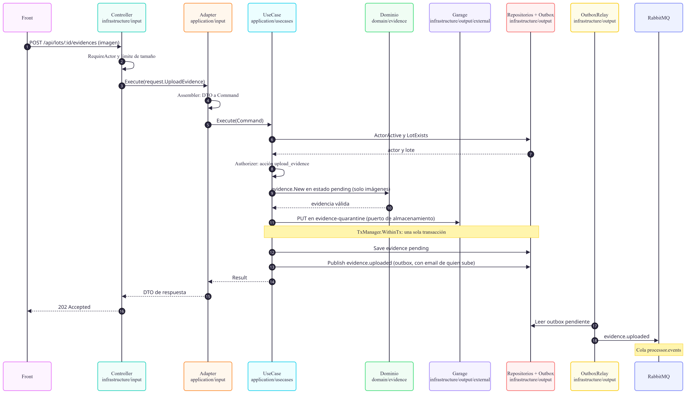

El procesador consume el evento, lee el archivo de la cuarentena, valida el tipo y el tamaño, calcula el SHA-256, genera una miniatura y elimina los metadatos EXIF. Si la imagen es válida, la mueve al bucket definitivo y publica `evidence.processed`; si no, publica `evidence.rejected` con el motivo. Tres servicios consumen el resultado: `traceability` actualiza el estado de la evidencia, `notifications` envía el correo y `qr` actualiza su vista.

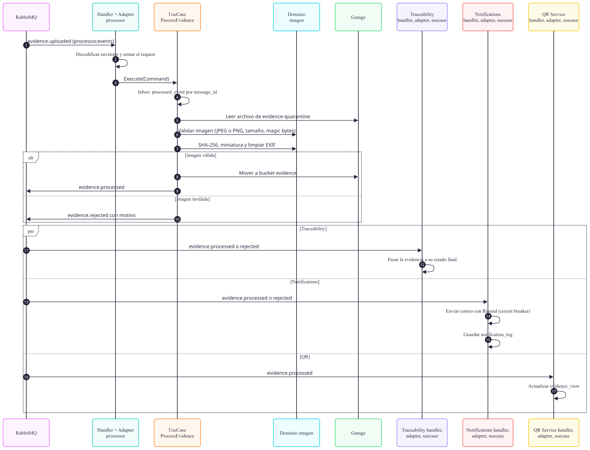

### 6.4 Consultar QR

El código impreso en la bolsa apunta a `/l/{id}`. El servicio `qr` busca la regla de redirección activa, comprueba que el lote exista, registra el escaneo y responde con una redirección `301` a la página del lote. El front obtiene entonces la ficha pública en `/api/public/lots/{id}`, que se sirve desde Redis cuando está disponible.

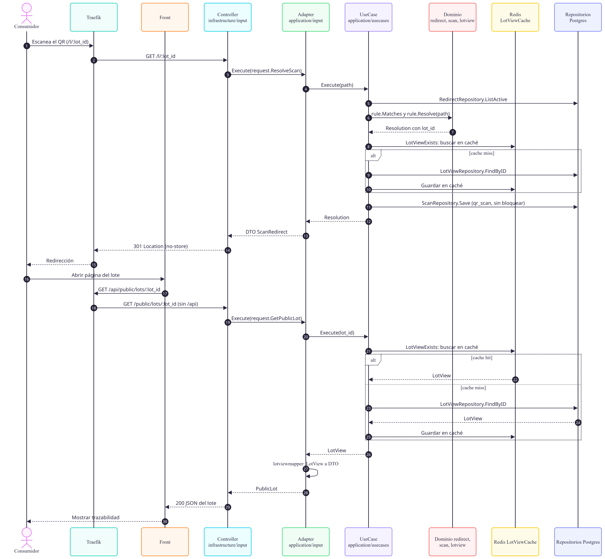

## 7. Diseño de Datos y Mensajería

### 7.1 Datos por servicio

Cada servicio tiene su propio esquema en PostgreSQL y las tablas no se comparten. El esquema se aplica fuera del servicio, de modo que el backend no crea tablas.

| Servicio | Tablas |
|---|---|
| `traceability` | `actor`, `farm`, `lot`, `lot_event`, `evidence`, `outbox`, `processed_event` |
| `qr` | `lot_view`, `lot_stage_view`, `evidence_view`, `qr_code`, `redirect`, `qr_scan`, `processed_event` |
| `processor`| `processed_event` |
| `notifications` | `processed_event`, `notification_log` |

### 7.2 Eventos

| Evento | Productor | Consumidores |
|---|---|---|
| `lot.created` | `traceability` | `qr` |
| `lot.stage_registered` | `traceability` | `qr` |
| `evidence.uploaded` | `traceability` | `processor` |
| `evidence.processed` | `processor` | `traceability`, `notifications`, `qr` |
| `evidence.rejected` | `processor` | `traceability`, `notifications` |
 
Todos los eventos viajan en un sobre común con los campos `id`, `type`, `version`, `occurred_at`, `correlation_id` y `data`. El campo `version` permite a los consumidores ignorar un estado más antiguo que el que ya tienen.

### 7.3 Mensajería
 
Se usa un único exchange de tipo *topic*, `rutadeorigen.events`, y una cola por consumidor, cada una con su cola de mensajes fallidos:
 
| Cola | Eventos |
|---|---|
| `qr.events` | `lot.*`, `evidence.processed` |
| `processor.events` | `evidence.uploaded` |
| `traceability.events` | `evidence.processed`, `evidence.rejected` |
| `notifications.events` | `evidence.processed`, `evidence.rejected` |
 
### 7.4 Almacenamiento de evidencias
 
Garage dispone de dos buckets: `evidence-quarantine`, donde se deposita el archivo original sin verificar, y `evidence`, que solo recibe archivos que el procesador aprobó. Cada servicio usa una llave de acceso con los permisos mínimos que necesita.
 
### 7.5 Manejo de errores
 
Las respuestas de error HTTP tienen la forma `{ code, error, kind, correlation_id }`. El campo `kind` clasifica el error y determina el estado HTTP. Los mensajes se definen en un catálogo YAML, sin textos fijos en el código.